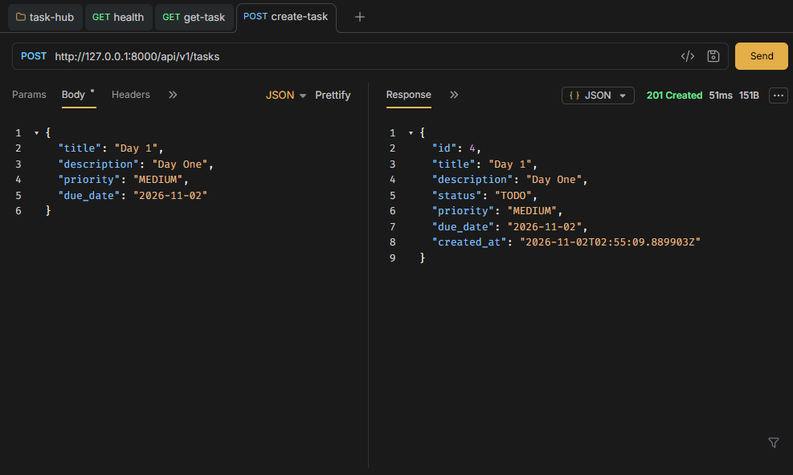
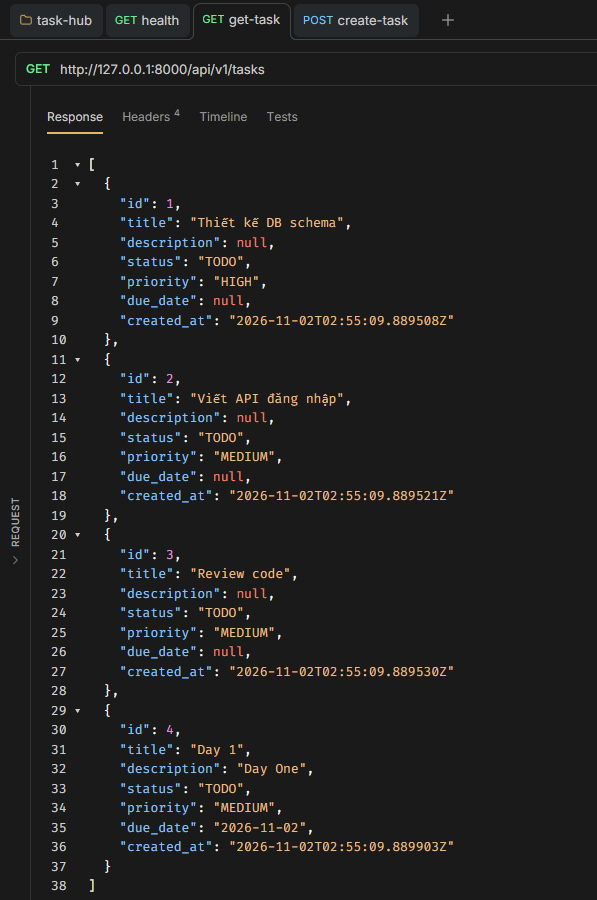
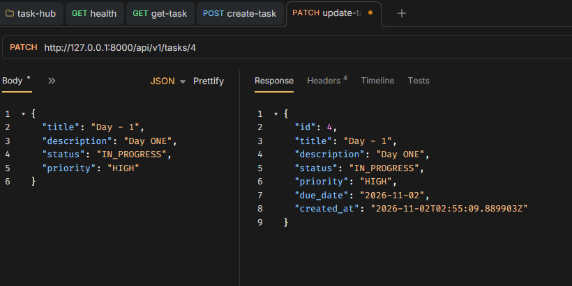
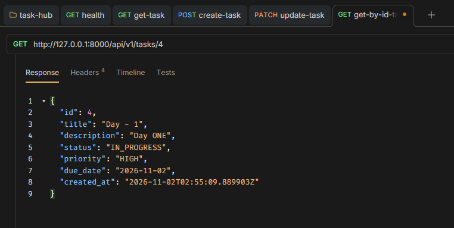
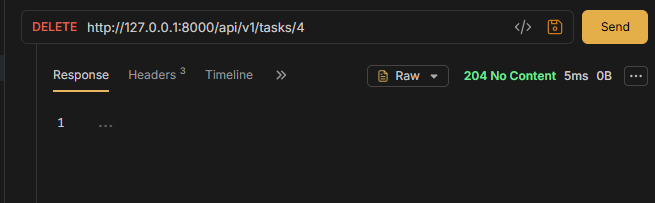
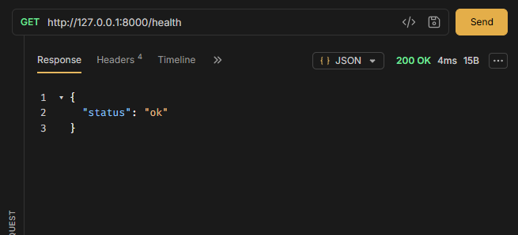

# Day 1: Core Setup & Architecture

## Nội dung

- Skeleton: FastAPI app, lifespan, APIRouter versioning /api/v1, GET /health
- Layered Architecture: schemas / models / services / routers
- Resource Task: CRUD (POST, GET list, GET by id, PATCH, DELETE)
- Pydantic v2 schemas, Dependency Injection (Depends)

## Endpoints

1. POST /api/v1/tasks/

2. GET /api/v1/tasks/

3. PATCH /api/v1/tasks/{task_id}

4. GET /api/v1/tasks/{task_id}

5. DELETE /api/v1/tasks/{task_id}

6. GET /health

