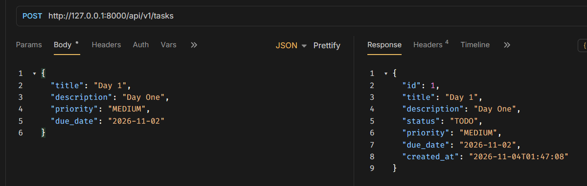
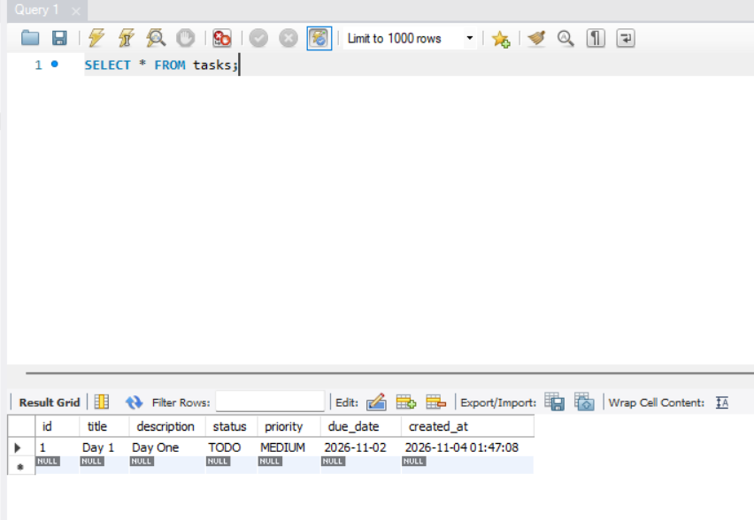

# Day 2: MySQL, SQLAlchemy async và Alembic

## Nội dung

- Chạy MySQL 8 trong Docker, kết nối được từ ứng dụng và MySQL Workbench.
- Thay kho dữ liệu trong bộ nhớ bằng MySQL qua SQLAlchemy 2.x async.
- Dùng Alembic tạo bảng `tasks` và lưu dữ liệu CRUD qua database.
- Xác nhận task vẫn tồn tại sau khi API được khởi động lại.

## Kiến trúc chạy local

- MySQL chạy trong Docker, cổng host `3308` (tuỳ chọn cổng host) ánh xạ vào cổng container `3306`.
- FastAPI chạy trên máy local bằng `uv`.
- MySQL Workbench kết nối tới `127.0.0.1:3308` để xem dữ liệu.
- Docker volume `mysql_data` giữ dữ liệu khi container dừng hoặc được tạo lại.

## Khởi động database

Tại thư mục `task-hub/`, sao chép file cấu hình mẫu:

```bash
cp .env.example .env
```

Khởi động MySQL và đợi tới khi trạng thái là `healthy`:

```bash
docker compose up -d mysql
docker compose ps
```

`docker compose down` chỉ dừng và xóa container, dữ liệu vẫn nằm trong volume. Không chạy `docker compose down -v` nếu muốn giữ database.

## Tạo schema bằng Alembic

```bash
uv sync
uv run alembic upgrade head
```

Migration tạo bảng `tasks` với các trường `id`, `title`, `description`, `status`, `priority`, `due_date`, `created_at`.

## Chạy API + CRUD

```bash
uv run fastapi dev src/task_hub/main.py
```



## Xem dữ liệu trong MySQL Workbench

Tạo kết nối mới:

| Trường | Giá trị |
|---|---|
| Hostname | `127.0.0.1` |
| Port | `3308` |
| Username | `YOUR_USERNAME` |
| Password | `YOUR_PASSWORD` |
| Default schema | `task-hub` |

Chạy truy vấn:

```sql
SELECT * FROM tasks;
```



## Persistence testing

Sau khi tạo task qua API:

```
docker compose down
```
>Lưu ý: `docker compose down -v` sẽ xóa volume và dữ liệu, không dùng nếu muốn giữ dữ liệu.

Sau đó chạy lại MySQL  

```
docker compose up -d mysql
```

Và truy vấn `SELECT * FROM tasks;` trong Workbench.

-> Task vẫn còn vì dữ liệu nằm trong MySQL Docker volume, không nằm trong bộ nhớ của ứng dụng.

Chạy test tích hợp khi MySQL đang healthy và migration đã áp dụng:

```bash
uv run pytest
uv run ruff check .
uv run ruff format --check .
uv run mypy
```

## Cấu trúc thư mục Ngày 2

```text
src/task_hub/
├── database.py
├── models/
│   ├── base.py
│   └── task.py
└── repositories/
    └── task.py

alembic.ini
migrations/
docker-compose.yml
.env.example
```

- `models/`: ORM model và metadata của SQLAlchemy.
- `repositories/`: truy vấn bất đồng bộ với `AsyncSession`.
- `database.py`: engine và session factory.
- `dependencies.py`: cấp session và service theo request.
- `migrations/`: lịch sử thay đổi schema được quản lý bởi Alembic.

## Tạo migration tiếp theo

Sau khi sửa model, tạo migration và xem lại file được sinh trước khi áp dụng:

```bash
uv run alembic revision --autogenerate -m "describe schema change"
uv run alembic upgrade head
```
